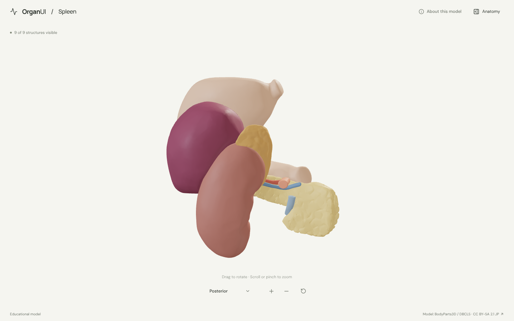
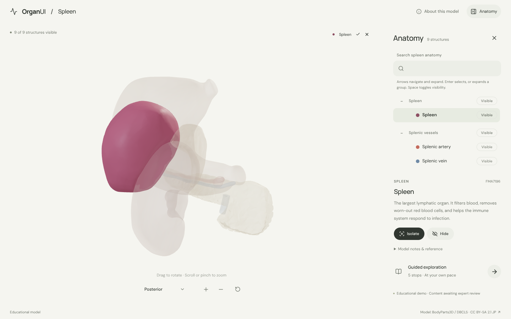
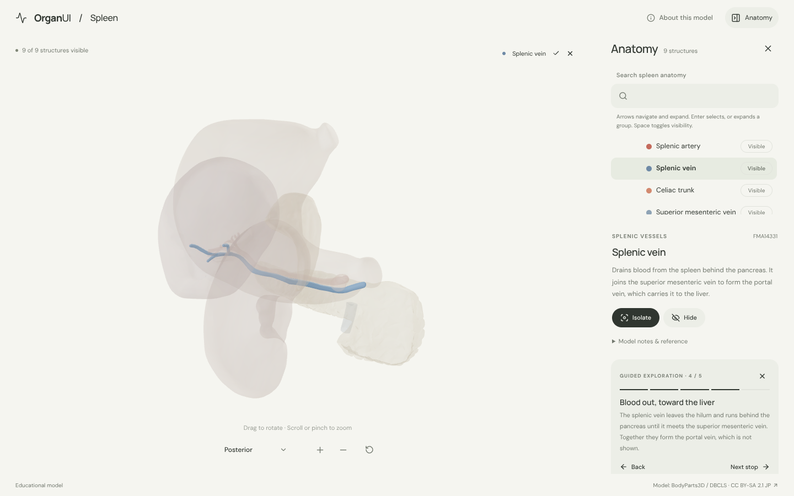
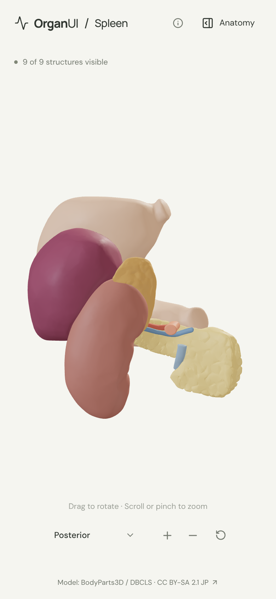
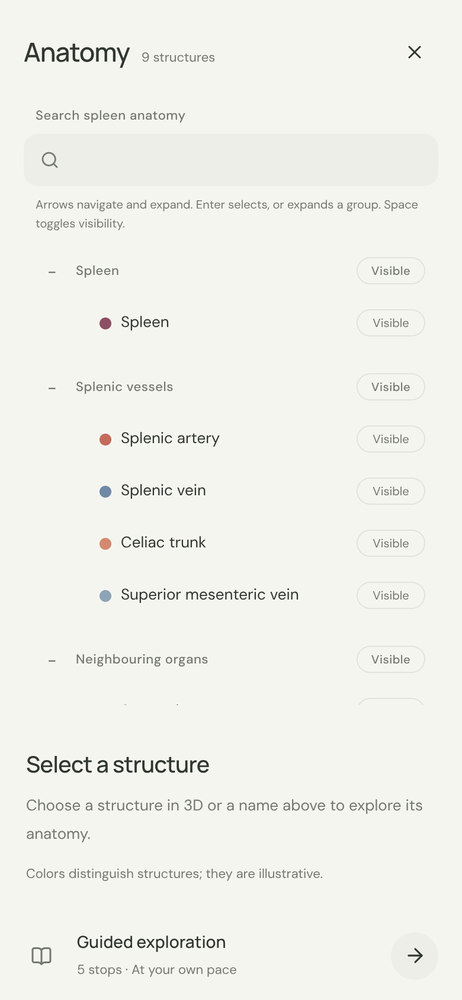

# OrganUI Spleen

A minimal, standalone, open-source spleen anatomy explorer built with React, TypeScript, Three.js, React Three Fiber, Vite, and Bun. It follows the [OrganUI Heart](https://github.com/organui/heart-3d) explorer's selection, framing, panel and toolbar behaviour.

**Status:** working local demo. Nine selectable structures (the spleen, its vessels and four neighbouring organs), a real bundled model, responsive layouts, and checked desktop/mobile interactions. Public deployment and clinical anatomy review have not been completed.



## Run locally

Install [Bun](https://bun.sh/) **1.4.2 or newer**, then:

```sh
git clone https://github.com/organui/spleen-3d.git
cd spleen-3d
bun install --frozen-lockfile
bun run dev
```

Open **http://127.0.0.1:5173**. No environment variables, accounts, API keys, sibling repositories, model downloads, or external font services are needed to run the app after dependency installation. The ready-to-use 1.7 MB GLB is in `public/models/`.

```sh
bun run typecheck       # TypeScript checks, including conversion scripts
bun run test            # Unit tests for selection emphasis, picking, and the anatomy-tree adapter
bun run verify:model    # Check the GLB hash, source IDs, and valid geometry
bun run build           # Typecheck and create dist/
bun run preview         # Serve the production build at http://127.0.0.1:4173
bun run format:check    # Check formatting of application and preparation code
```

The app is static and uses relative build paths. `dist/` can be hosted on any static web server; do not open `index.html` directly with `file://`. No deployment has been performed.

## Explore

- The spleen opens in the **posterior** view, where the spleen, its vessels and the left kidney are all visible. From the front, the stomach covers most of the spleen.
- Drag to rotate; scroll or pinch to zoom. The view menu offers anterior, posterior and left lateral presets; manual rotation changes its label to **Custom view**.
- Open **Anatomy** from the header to browse the tree (the OrganUI registry `anatomy-tree` component). Selecting a structure in 3D or in the tree keeps it solid with a soft glow and ghosts everything else. The name chip above the canvas opens the panel; Escape closes it and returns focus to the toggle.
- Isolate a structure, hide it, or restore all. Group rows show or hide all their structures. **Reset explorer** restores the posterior camera, visibility, selection, tree search/expansion and tour state.
- Follow five guided stops: the spleen's position, the stomach, the splenic artery, the splenic vein, and the isolated spleen.
- Focus the model and use arrow keys to rotate, `+`/`-` to zoom. All anatomy text is available without WebGL.

<details>
<summary>Anatomy panel, guided exploration and mobile screenshots</summary>









</details>

## Model, credits, and review status

> BodyParts3D, © The Database Center for Life Science licensed under CC Attribution-Share Alike 2.1 Japan.

The model is a curated subset of **BodyParts3D 3.0**, taken from the STL copy in [Kevin-Mattheus-Moerman/BodyParts3D](https://github.com/Kevin-Mattheus-Moerman/BodyParts3D) on **16 October 2026**. That copy carries **CC BY-SA 2.1 Japan**, so the adapted `spleen.glb` is shared under the same license, separately from this repository's **MIT code license**. The heart, brain, liver and kidney explorers use BodyParts3D 4.0 from the official archive under CC BY 4.0; [model provenance](docs/MODEL_PROVENANCE.md) explains the difference and how to move to that source.

Read [model provenance and preparation](docs/MODEL_PROVENANCE.md), [asset attribution](public/models/ATTRIBUTION.md), and the [checksum manifest](public/models/manifest.json). Fonts are bundled under the SIL Open Font License; [third-party notices](public/licenses/README.md) are included in the production output.

Names were checked against the source parts list and geometry was inspected. Descriptions summarize the [NCI SEER Training spleen page](https://training.seer.cancer.gov/anatomy/lymphatic/components/spleen.html). **Expert anatomical review is pending.** This is an educational interface demonstration, not a diagnostic or measurement tool.

Known limitations:

- The spleen is one surface. Its hilum, poles, capsule, pulp and ligaments are not separate structures.
- The portal vein, aorta, diaphragm and colon are omitted; the superior mesenteric vein is a short segment. Vessel ends are truncated and colors are illustrative.
- This is a simplified adult male reference model, not a complete or patient-specific anatomy.
- Browser checks used headless desktop Chromium and a mobile viewport, not physical devices or a screen-reader audit.

## Reproduce the model

The runtime asset is included. To rebuild it from verified upstream inputs:

```sh
bun run prepare:model
bun run verify:model
```

This downloads ten pinned files (about 3.5 MB) into ignored `.asset-cache/`, verifies their SHA-256 hashes, and exports the GLB plus manifest. Conversion selects real meshes, welds STL vertices, transforms coordinates, recomputes normals and applies colors; it does not invent or simplify geometry.

## Implementation

- `src/anatomy.ts`: source-ID mappings, explanatory text, default view and guided stops.
- `src/App.tsx`: selection/visibility state and accessible interface controls.
- `src/components/ui/anatomy-tree.tsx`: OrganUI registry component installed with the shadcn CLI; tracked unmodified ([registry integration](docs/REGISTRY_INTEGRATION.md)).
- `src/anatomy-adapter.ts`: tree data, group/leaf mapping, and visibility conversion for this scene.
- `src/framing.ts`: shared framing rule, identical in every OrganUI explorer.
- `src/Viewer.tsx`, `src/ViewMenu.tsx`, `src/SceneCanvas.tsx`: loading, picking, camera controls and recoverable graphics failures.
- `scripts/`: pinned source inputs, reproducible conversion, and runtime validation.

## License

Original application code: [MIT](LICENSE). The anatomy model, derived model images, fonts, and icons retain their separately documented licenses.

Part of [OrganUI](https://github.com/organui).
